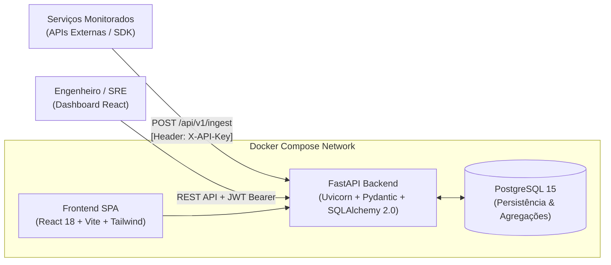

  <h1>⚡ DataPulse — API Observability & Telemetry Platform</h1>
  

    <strong>Plataforma Full-Stack de Observabilidade, Ingestão de Telemetria em Tempo Real, Agregação de Métricas e Monitoramento Proativo de Incidentes.</strong>
  

  

    
    
    
    
    
    
  

---

## 🎯 Visão Geral & Problema Resolvido

Em arquiteturas modernas baseadas em microsserviços e APIs REST, a falta de visibilidade sobre latência por endpoint, taxas de falhas (`4xx`/`5xx`) e degradação silenciosa de performance compromete diretamente o SLA da operação.

O **DataPulse** foi projetado como um ecossistema completo de **APM (Application Performance Monitoring) e Telemetria** que permite a times de engenharia:

1. **Provisionamento Multi-Serviço:** Registrar múltiplas aplicações e emitir credenciais criptográficas isoladas de ingestão (`X-API-Key`).
2. **Ingestão de Baixo Overhead:** Capturar eventos de requisições HTTP (`endpoint`, `method`, `status_code`, `response_time_ms`) via endpoint dedicado de alta vazão.
3. **Observabilidade & Diagnóstico:** Consolidar indicadores críticos de saúde (Volume Total, Latência Média, Taxa de Erro, Disponibilidade/SLA e Ranking de Gargalos).
4. **Monitoramento Proativo:** Configurar regras dinâmicas de alerta baseadas em *thresholds* críticos de latência ou códigos de falha HTTP.

---

## 🏗️ Arquitetura do Sistema & Decisões Técnicas

O projeto adota uma estrutura **Monorepo** totalmente containerizada, isolando rigorosamente as responsabilidades de ingestão/processamento (Backend) e visualização analítica (Frontend).

### ⚙️ Engenharia de Backend (Destaque Arquitetural)

O núcleo do **DataPulse** (`backend/app/`) foi construído seguindo os princípios de **Clean Architecture e Separation of Concerns (SoC)**, garantindo alta manutenibilidade, testabilidade e escalabilidade:

* **Arquitetura em Camadas Desacopladas:**
  * `api/v1/endpoints/`: Controladores REST versionados (`auth`, `users`, `applications`, `ingest`, `metrics`, `alerts`), responsáveis exclusivamente pelo contrato HTTP, validação de entrada e injeção de dependências (`Depends`).
  * `services/`: Camada de regras de negócio puras, isolando a lógica de cálculo de métricas, avaliação de *thresholds* de alerta, geração de chaves e operações transacionais.
  * `schemas/`: Contratos estritos de entrada e saída com **Pydantic v2** (`BaseModel`, `ConfigDict`), garantindo serialização segura e prevenção contra exposição acidental de dados sensíveis (como hashes de senha ou API Keys secretas após o provisionamento).
  * `models/`: Entidades relacionais mapeadas com **SQLAlchemy 2.0** (`DeclarativeBase`), modelando o domínio (`User`, `Application`, `Metric`, `AlertRule`).
  * `core/` & `db/`: Gestão centralizada de segurança, hashing de senhas, emissão/validação de tokens JWT e ciclo de vida de sessões do banco (`SessionLocal` com encerramento garantido via `yield`).

* **Modelo de Autenticação Dupla (Segurança por Contexto):**
  * **Plano de Controle (Gestão via OAuth2 + JWT):** Rotas administrativas de criação de aplicações, consulta de dashboards e gestão de alertas são protegidas por tokens **JWT (HS256)** com expiração configurável e isolamento multi-tenant por usuário autenticado.
  * **Plano de Dados (Ingestão via `X-API-Key`):** A rota de telemetria (`/api/v1/ingest/`) utiliza autenticação dedicada via header `X-API-Key` vinculada diretamente à aplicação monitorada, eliminando a necessidade de renovação de tokens em agentes ou serviços de produção.

* **Motor de Agregação & Observabilidade:**
  * Processamento analítico via queries otimizadas no PostgreSQL para cálculo instantâneo de volume de tráfego, latência média global, taxa percentual de erros e identificação dos **endpoints mais lentos (Gargalos)** ordenados por tempo médio de resposta.

* **Resiliência de Infraestrutura:**
  * Orquestração via **Docker Compose** com `healthcheck` nativo (`pg_isready`) no PostgreSQL, garantindo que a API FastAPI só inicie após o banco estar 100% pronto para aceitar conexões, além de suporte a *Hot Reload* em desenvolvimento e configuração de `CORSMiddleware`.

---

### 🎨 Frontend Observability Dashboard

Construído em **React 18 + Vite + Tailwind CSS**, o painel foi desenhado com estética *Dark Mode* inspirada em ferramentas modernas de SRE (Datadog / Grafana / Vercel):

* **KPIs em Tempo Real:** Cards analíticos com cálculo dinâmico de Total de Requisições, Latência Média (`ms`), Taxa de Erro (`%`) e SLA de Disponibilidade.
* **Visualização de Dados (Recharts):** Gráficos interativos de distribuição entre requisições saudáveis (`2xx`/`3xx`) e falhas (`4xx`/`5xx`), acompanhados de tabela analítica dos endpoints com maior latência.
* **Gestão de Chaves & Simulador de Tráfego Integrado:** Interface para emissão segura de `X-API-Key` com cópia rápida e **Simulador de Telemetria em 1 clique** (dispara lotes reais de eventos HTTP variados para validação imediata do pipeline de ingestão).
* **Gestão de Regras de Alerta:** Configuração granular de *thresholds* por aplicação para latência (`response_time_ms`) ou códigos de erro HTTP (`status_code`).

---

## 📂 Estrutura do Monorepo

<pre><code>datapulse/
├── backend/
│   ├── app/
│   │   ├── api/
│   │   │   ├── deps.py               # Injeção de dependências (DB, Current User, API Key)
│   │   │   └── v1/
│   │   │       ├── api.py            # Agregador de rotas v1
│   │   │       └── endpoints/        # auth, users, applications, ingest, metrics, alerts
│   │   ├── core/                     # Configurações de segurança, JWT e hashing
│   │   ├── db/
│   │   │   └── session.py            # Engine SQLAlchemy 2.0 e gerenciador de sessões
│   │   ├── models/                   # Modelos ORM (User, Application, Metric, AlertRule)
│   │   ├── schemas/                  # Contratos Pydantic de Request/Response
│   │   ├── services/                 # Regras de negócio, agregações e motor de alertas
│   │   └── main.py                   # Entrypoint FastAPI, CORS e inicialização de tabelas
│   ├── Dockerfile
│   ├── requirements.txt
│   └── .env.example
├── frontend/
│   ├── src/
│   │   ├── components/               # Layout (Sidebar), StatCard e componentes visuais
│   │   ├── contexts/                 # AuthContext (gerenciamento global de sessão JWT)
│   │   ├── pages/                    # Login, Dashboard, Applications, Alerts
│   │   ├── services/                 # Cliente Axios com interceptors de autenticação
│   │   ├── App.jsx                   # Roteamento protegido (PrivateRoute)
│   │   └── main.jsx
│   ├── Dockerfile
│   ├── package.json
│   ├── tailwind.config.js
│   └── vite.config.js
├── docker-compose.yml                # Orquestração completa (db + backend + frontend)
├── .gitignore
└── README.md</code></pre>

---

## 🔌 Principais Endpoints da API

A documentação interativa completa (OpenAPI / Swagger UI) fica disponível automaticamente em `/docs` com a aplicação rodando.

| Método | Rota | Autenticação | Descrição |
| :--- | :--- | :---: | :--- |
| `POST` | `/api/v1/users/` | Pública | Cadastro de novo engenheiro/usuário na plataforma |
| `POST` | `/api/v1/auth/login` | OAuth2 Form | Autenticação e emissão de token JWT Bearer |
| `GET` | `/api/v1/users/me` | `Bearer JWT` | Retorna o perfil do usuário autenticado |
| `POST` | `/api/v1/applications/` | `Bearer JWT` | Cria uma nova aplicação monitorada e gera sua `X-API-Key` |
| `GET` | `/api/v1/applications/` | `Bearer JWT` | Lista todas as aplicações pertencentes ao usuário |
| `POST` | `/api/v1/ingest/` | `X-API-Key` | **Endpoint de Alta Vazão** para ingestão de eventos de telemetria |
| `GET` | `/api/v1/metrics/summary/{app_id}` | `Bearer JWT` | Retorna KPIs consolidados (total, latência média, taxa de erro) |
| `GET` | `/api/v1/metrics/slowest/{app_id}` | `Bearer JWT` | Lista os endpoints com maior tempo médio de resposta |
| `POST` | `/api/v1/alerts/rules` | `Bearer JWT` | Cria uma regra de alerta baseada em *threshold* |
| `GET` | `/api/v1/alerts/rules/{app_id}` | `Bearer JWT` | Lista as regras de monitoramento ativas da aplicação |

---

## 🚀 Como Executar Localmente (1 Comando)

### Pré-requisitos
* **Docker** e **Docker Compose** instalados.

### Passo a Passo

1. **Clone o repositório:**
<pre><code>git clone https://github.com/SEU_USUARIO/datapulse.git
cd datapulse</code></pre>

2. **Configure as variáveis de ambiente do backend:**
<pre><code>cp backend/.env.example backend/.env</code></pre>

3. **Suba toda a infraestrutura (PostgreSQL + FastAPI + React):**
<pre><code>docker compose up -d --build</code></pre>

4. **Acesse os serviços:**
   * **Dashboard Web (Frontend):** `http://localhost:5173`
   * **Documentação Interativa Swagger (API):** `http://localhost:8000/docs`
   * **Health Check da API:** `http://localhost:8000/`

---

## 🧪 Testando o Fluxo Completo em 30 Segundos

1. Acesse `http://localhost:5173` e crie uma conta na tela de registro.
2. No menu lateral, acesse **Aplicações & Keys** e registre um novo serviço (ex: `Payment Gateway API`).
3. Copie a `X-API-Key` gerada e clique no botão **"Simular Tráfego"** no card da aplicação — o frontend disparará 10 eventos reais de telemetria para a rota `POST /api/v1/ingest/`.
4. Volte para o **Dashboard** para visualizar os KPIs recalculados, o gráfico de distribuição de respostas e o ranking dos endpoints mais lentos.
5. Opcionalmente, envie eventos diretamente via `cURL` de qualquer terminal:

<pre><code>curl -X POST "http://localhost:8000/api/v1/ingest/" \
  -H "Content-Type: application/json" \
  -H "X-API-Key: SUA_API_KEY_AQUI" \
  -d '{
    "endpoint": "/api/v1/orders",
    "method": "POST",
    "status_code": 201,
    "response_time_ms": 142.5
  }'</code></pre>

---

## 🗺️ Roadmap de Evolução

* [ ] Processamento assíncrono de ingestão em fila com **Redis / Celery** para picos extremos de tráfego.
* [ ] Notificações de incidentes em tempo real via **Webhooks (Slack / Discord / Teams)**.
* [ ] Agregação temporal em janelas deslizantes (últimos 15m, 1h, 24h, 7d) com **TimescaleDB**.
* [ ] Suite de testes automatizados com **Pytest** e pipeline de CI no **GitHub Actions**.

---

  Desenvolvido com foco em arquitetura limpa, performance e observabilidade.

